# Diagrama de Classes UML — BLOCKREADY

Diagrama compatível com o código implementado (Etapa 5). Renderizável no GitHub/VS Code (Mermaid).

Padrões aplicados: **MVC** (controllers → services → repositories), **DAO** (Spring Data JPA repositories),
**Strategy** (`AnalysisStrategy`/`PriorizacaoStrategy`), **herança** (`RecursoComunitario` e subtipos, JOINED),
**encapsulamento** (estado alterado apenas por métodos de domínio com invariantes), **abstração**
(`EntidadeBase`, `DetalhesRecurso`, interfaces de estratégia e importação) e **polimorfismo**
(`aplicarDetalhes`, `detalhesEspecificos`, `descreverCapacidade`, estratégias e importadores).

```mermaid
classDiagram
    direction LR

    class EntidadeBase {
        <<abstract>>
        -Long id
        -Instant criadoEm
        -Instant atualizadoEm
    }

    class Usuario {
        -String nome
        -String email
        -String senhaHash
        -Perfil perfil
        -boolean ativo
        +alterarPerfil(Perfil)
        +ativar() / desativar()
    }

    class Organizacao {
        -String nome
        -TipoOrganizacao tipo
        -StatusAprovacao statusAprovacao
        -String responsavelNome
        +aprovar() / rejeitar() / suspender()
        +estaAprovada() boolean
    }

    class RecursoComunitario {
        -String nome
        -CategoriaRecurso categoria
        -double latitude / longitude
        -BigDecimal capacidadeTotal
        -BigDecimal capacidadeDisponivel
        -String unidadeMedida
        -StatusRecurso status
        +atualizarDisponibilidade(total, disponivel)
        +validar(Usuario) / rejeitar(Usuario)
        +aplicarDetalhes(DetalhesRecurso)*
        +detalhesEspecificos()* Map
        +descreverCapacidade()* String
    }

    class PontoAgua { -boolean potavel -String tipoFonte }
    class Abrigo { -boolean aceitaAnimais -boolean possuiRefeitorio }
    class PontoEnergia { -String tipoFonte -boolean permiteCarregarDispositivos }
    class PontoAlimentos { -boolean refrigeracao -String tipoAlimento }

    class RegistroDisponibilidade { -BigDecimal capacidadeTotal -BigDecimal capacidadeDisponivel -Instant registradoEm }
    class RecursoHistorico { -String acao -String descricao }
    class Necessidade { -CategoriaRecurso categoria -BigDecimal quantidade -Prioridade prioridade }
    class Solicitacao { -StatusSolicitacao status +transitarPara(status, ator, registro) }
    class SolicitacaoHistorico { -StatusSolicitacao statusAnterior -StatusSolicitacao statusNovo }
    class Voluntario { -String habilidades -String disponibilidade -boolean ativo }
    class AuditoriaRegistro { -String acao -String entidade -Long entidadeId }

    class FonteExterna { -String codigo -AbrangenciaFonte abrangencia -Instant ultimaImportacao +registrarImportacao() }
    class ImportacaoDataset { -String nomeArquivo -String hashArquivo -StatusImportacao status -int totalProcessados -int totalRejeitados +concluir() +falhar() }
    class SetorCensitario { -String codigoSetor -int populacao -int domicilios -MultiPolygon geometria +atualizar(...) }
    class RegistroMeteorologico { -String estacaoCodigo -Instant medidoEm -BigDecimal precipitacaoMm }
    class RegistroDesastre { -String tipoDesastre -LocalDate ocorridoEm -int afetados -int desabrigados }

    class CenarioEmergencia { -TipoEmergencia tipo -int horizonteHoras -BigDecimal percentualAfetados -String estrategia }
    class IndicadorCobertura { -CategoriaRecurso categoria -BigDecimal capacidadeDisponivel -BigDecimal demandaEstimada -BigDecimal percentual -SituacaoCobertura situacao }

    class AnalysisStrategy~I,O~ {
        <<interface>>
        +key() String
        +analyze(I) O
    }
    class PriorizacaoStrategy {
        <<interface>>
        +titulo() String
    }
    class PriorizacaoBase {
        <<abstract>>
        #pesos()* Map
        #acaoPara(categoria)* String
        +analyze(CriResponse) List~RecomendacaoResponse~
    }
    class EstrategiaEnchente
    class EstrategiaTempestade
    class EstrategiaInterrupcaoEnergia
    class EstrategiaInterrupcaoServicos
    class EstrategiaPadrao

    class ImportadorDataset {
        <<interface>>
        +fonteCodigo() String
        +validarCabecalho(CsvArquivo)
        +importar(CsvArquivo, ImportacaoDataset) Resultado
    }
    class ImportadorIbgeCenso
    class ImportadorCemaden
    class ImportadorAtlasDesastres

    class CriService { +calcular(parametros, pctAfetados, horizonte, categorias) CriResponse }
    class InsightService { +todos() List~InsightResponse~ }
    class CenarioService { +simular(req) +salvar(req, ator) }
    class ImportacaoService { +importar(fonte, arquivo, periodo, demo, ator) }

    EntidadeBase <|-- Usuario
    EntidadeBase <|-- Organizacao
    EntidadeBase <|-- RecursoComunitario
    EntidadeBase <|-- Necessidade
    EntidadeBase <|-- Solicitacao
    EntidadeBase <|-- Voluntario
    EntidadeBase <|-- FonteExterna
    EntidadeBase <|-- SetorCensitario
    EntidadeBase <|-- CenarioEmergencia

    RecursoComunitario <|-- PontoAgua
    RecursoComunitario <|-- Abrigo
    RecursoComunitario <|-- PontoEnergia
    RecursoComunitario <|-- PontoAlimentos

    Usuario "0..*" --> "0..1" Organizacao : pertence a
    Voluntario "1" --> "1" Usuario
    Organizacao "1" --> "0..*" RecursoComunitario : responsável por
    RecursoComunitario "1" --> "0..*" RegistroDisponibilidade
    RecursoComunitario "1" --> "0..*" RecursoHistorico
    Necessidade "1" --> "0..1" Solicitacao : gera
    Solicitacao "1" --> "0..*" SolicitacaoHistorico
    Usuario "0..1" --> "0..*" Solicitacao : responsável
    FonteExterna "1" --> "0..*" ImportacaoDataset
    ImportacaoDataset "1" --> "0..*" SetorCensitario
    ImportacaoDataset "1" --> "0..*" RegistroMeteorologico
    ImportacaoDataset "1" --> "0..*" RegistroDesastre
    CenarioEmergencia "1" --> "0..*" IndicadorCobertura
    Usuario "1" --> "0..*" CenarioEmergencia : criou

    AnalysisStrategy <|-- PriorizacaoStrategy
    PriorizacaoStrategy <|.. PriorizacaoBase
    PriorizacaoBase <|-- EstrategiaEnchente
    PriorizacaoBase <|-- EstrategiaTempestade
    PriorizacaoBase <|-- EstrategiaInterrupcaoEnergia
    PriorizacaoBase <|-- EstrategiaInterrupcaoServicos
    PriorizacaoBase <|-- EstrategiaPadrao

    ImportadorDataset <|.. ImportadorIbgeCenso
    ImportadorDataset <|.. ImportadorCemaden
    ImportadorDataset <|.. ImportadorAtlasDesastres

    CenarioService --> CriService
    CenarioService --> PriorizacaoStrategy : seleciona por key
    InsightService --> CriService
    InsightService --> EstrategiaPadrao
    ImportacaoService --> ImportadorDataset : resolve por fonte
```



## Camadas (MVC + DAO)

```mermaid
flowchart LR
    V[Frontend estático\nHTML/CSS/JS puro] -->|fetch /api/v1| C[Controllers\n@RestController]
    C --> S[Services\nregras de negócio]
    S --> R[Repositories\nSpring Data JPA = DAO]
    R --> DB[(PostgreSQL + PostGIS\nFlyway migrations)]
    S --> ST[Strategies\npriorização por cenário]
    S --> IMP[Importadores\nIBGE / CEMADEN / Atlas]
```
